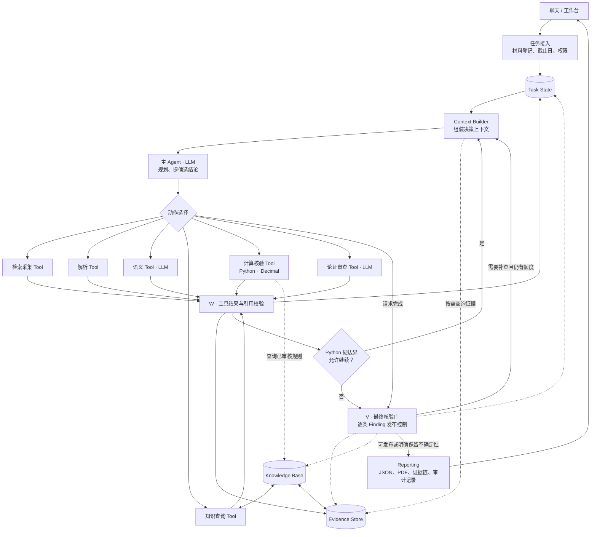

# FinTrace 独立版方案（v1）

2026-10-10 ｜ 起草：Hermes ｜ 复核：谷纪瑄（待你审）

> 这份文件是**独立版**的方案，不是对团队仓库的改造计划。
> 你确认后，按第 10 节的顺序落成可运行代码（目录名暂定 `G:/项目/fintrace-agent/`）。

---

## 0. 先界定三件事

**一、独立版指什么。**

- 独立版**不 import 团队仓库**（`G:/项目/fintrace`），也不动它任何一行。
  零件以「复制文件 + 记录来源 commit」的方式搬进来。等独立版跑通、评测不掉，再谈反向合并。
- 理由不是洁癖：团队仓库现在是 10-08 的封存状态（`origin/main` 停在 `f6e8fae`），
  初赛 10-18 交的是计划书与视频。独立版让架构实验和交付物互不干扰。

**二、与 `fintrace-solo` 的关系。** `solo`（1699 行、10 个模块）是**固定链路**的最小实现：
原始 PDF → 页码定位 → 字段抽取 → `Decimal` 复算 → 可追溯发现。它缺的正是本方案要加的那一层：
可恢复状态、硬边界、知识库、发布门。所以独立版＝把 solo 的确定性零件搬过来当骨架，
再把「固定链路」换成「受约束的回路」。solo 本身不动。

**三、本轮实测基线（2026-10-10 前台真跑，不是抄文档）。**

| 项 | 读数 | 命令 |
|---|---|---|
| 团队仓库 HEAD | `f43418b`，工作区干净 | `git log -1` |
| 回归 | **294 通过 / 2 跳过**，退出码 0 | `pytest tests -q`（跳过的是联网用例） |
| 案例级评测 | 覆盖 1.0000、标签 **26/26**、TP 12 / FP 0 / FN 0、原件回查 **19/19**，退出码 0 | `tools/run_draft_eval.py` |
| 反例守门 | 六节反例全部符合预期，退出码 0 | `tools/check_guardrails.py` |

这三个数就是独立版每一步的**验收基线**：任何一步做完，这三个读数一个都不许掉。

---

## 1. 总纲

一句话：**动作是工具，顺序写死，知识可查，模型只在枚举动作里选一步，硬边界能否决但选不了，
判定权始终在代码，发布权在核验门。**

| 角色 | 是谁 | 职责 | 能不能说「不」 | 出处 |
|---|---|---|---|---|
| Agent | 大模型（DeepSeek） | 只选下一步动作 | 不能。它只能「请求结束」 | 决策 JSON |
| Python 执行与约束 | 确定性代码 | 执行工具、硬边界、W 门、V 门 | 能。终止权在它手里 | `agent/bounds.py`、`tools/validator.py`、`gate/` |
| Task State | 落盘 JSON | 执行记忆，也是决策上下文的唯一来源 | — | `runs/<run_id>/state.json` |
| 证据库 | 落盘证据 + 原件 | 事实来源；过 W 才进，出结论前还要过 V | — | `runs/<run_id>/evidence.jsonl` |
| 知识库 | 数据文件 | 领域规则：概念、公式、关系、适用条件 | 不能覆盖代码判定 | `knowledge/` |
| 最终核验门 V | 确定性检查 + 按需审查模型 | 逐条 Finding 的发布控制 | 能。它决定哪条能发 | `gate/finding_gate.py` |

**三条不可让渡的规则**（写进代码注释，也写进计划书）：

1. **终止权不在模型手里。** 模型只有「请求结束」这一个动作，接不接受由 V 门决定。
2. **判定权不在模型手里。** 数值、单位、口径、标签全部来自确定性代码；模型看不到也算不了。
3. **发布权不在模型手里。** 每条 Finding 单独裁决，通过则发布，不通过则降级或继续调查。

---

## 2. 图与逐格对照



逐格对照（「现在有什么」是 2026-10-10 读代码得到的，行数为实测）：

| 图上那格 | 团队仓库现在是什么 | 独立版怎么做 | 归属 |
|---|---|---|---|
| 任务接入 | 导入接口 + `parsers/report_identity.py`(322) 自动识别 + `cutoff_filter.py`(78) 硬门；**权限只有业务越界规则**（`agent_shell.py` 919） | 增加工具级 `allowed_tools`（见 4.1）；接入逻辑照搬 | 搬 + 补 |
| Task State | **缺**。`stages.stage1~stage5b` 是单次运行记录，加 `run_log_id` / `artifact_fingerprint` | 新建，原子写 JSON，跨进程可恢复 | 新写 |
| Context Builder | **缺** | 新建（4.3） | 新写 |
| 主 Agent 规划 | **缺且不是现在这个**。`agent_shell.classify()` 只把话分四类，然后走固定链路 | 新建 planner，只能在六个动作里选 | 新写 |
| 检索采集 Tool | 有：`sourcing/cninfo.py`(371) 巨潮官方枚举（代码→orgId→公告→正文，标准库 urllib） | 照搬。**不引入通用搜索**，理由见 11.1 | 搬 |
| 解析 Tool | 有：`parsers/pdf_pages.py`(88)、`report_identity.py`(322)、`draft_review.py` 的表格网格与行列绑定 | 照搬，但把「绑定」从判定文件里抽成独立模块 | 搬 + 拆 |
| 语义 Tool（LLM 抽取） | 有：`llm.py`(248) `decompose_claims()` | 照搬；产物必须过 W 才登记 | 搬 |
| 知识查询 Tool | **没有独立库**。`METRICS` 在 `draft_review.py:52`、`PRECISION` 在 `:162`，与判定同在 2711 行文件里 | 抽出成 KB 数据 + 查询接口（第 6 节） | 新写 + 搬内容 |
| 计算核验 Tool | 有：`calculators/consistency.py`(56) 是唯一算术源、`ratios.py`(123)，判定在 `draft_review.py` | 照搬；判定链拆成五层（Claim→Retrieval→Qualification→Verification→Audit） | 搬 + 拆 |
| 论证审查 Tool（LLM） | 有：`verification/explanation_guard.py`(512) 解释守门人 | 照搬，默认关闭，只在 V 的定性环节开 | 搬 |
| W（工具结果校验） | **散在三处**：`explanation_guard` 的事实分类与引用绑定、`draft_review` 的 `num_in_text`/`page_has_value`/`value_spellings`、`tools/run_draft_eval.py` 的原件回查 | 收敛成一个入口 `tools/validator.py` | 收敛 |
| 证据与事实库 | 有结构（evidence 带 `value`/`unit`/`raw`/`row_label`/`page`），但**跨轮不累积**，每次运行重算 | 落 `evidence.jsonl`，跨轮累积，带 `evidence_id` | 新写 |
| 财务知识库 | **最弱的一格**：规则是代码不是数据 | 新建（第 6 节） | 新写 |
| 循环控制器 | **完全没有**（`planner` / `budget` / `max_steps` / `checkpoint` 全空） | 新建，两层决策（第 4 节），移植 Hermes 的 `iteration_budget` 与打转守门 | 新写 + 移植 |
| 最终核验门 | 有，但**是离线脚本**（`check_guardrails.py` 六节 + `run_draft_eval.py` 的 `audit_content` 与原件回查），不是运行时回路的终点 | 改成运行时可调用的门（第 8 节） | 改造 |
| Reporting | 有：`reporting/pdf_report.py`(495) 原文红框 + 内链、`risk_report.py`(122)、`dividend_report.py`(158) | 照搬，加 Finding 级发布决定字段 | 搬 |

---

## 3. 四个持久化对象（先把契约定死）

### 3.1 Task State（执行记忆，也是决策上下文的唯一来源）

```jsonc
{
  "schema_version": 1,
  "run_id": "FT-20261010-xxxxxxxx",
  "artifact_fingerprint": "…",          // 沿用现有口径：输入 + 本次实际采用的主张集
  "goal":     { "task": "draft_review", "case_id": "…", "company": "…", "period": "2023A" },
  "bounds":   { "cutoff_date": "…", "max_tool_calls": 24, "token_budget": 40000,
                "deadline_ts": 0, "cancel_requested": false, "allowed_tools": ["t_search", "…"] },
  "counting": { "tool_calls": 0, "tokens": 0, "sig_repeats": 0, "invalid_decisions": 0 },
  "claims":   [ { "claim_id": "C001", "assertion": "…", "status": "open",
                  "open_questions": [], "evidence_ids": [], "blocked_reason": null } ],
  "steps":    [ { "n": 1, "tool": "t_parse", "args_digest": "…", "result_digest": "…",
                  "new_evidence": 3, "ms": 812 } ],
  "stop":     { "requested_by_model": false, "reason": null }
}
```

关键字段是 `steps[].new_evidence`：**增量信号靠它，不靠翻历史。**

### 3.2 Evidence（只有过 W 才进）

沿用现有字段，只加一个跨轮标识：

```jsonc
{ "evidence_id": "E-0007", "source_id": "…", "source_type": "annual_report",
  "announcement_id": "…", "pub_date": "2024-03-29", "page": 51, "row_label": "…",
  "value": "408548.46", "unit": "元", "raw": "408,548.46", "quoted_text": "…",
  "admitted_by": "W", "admitted_at": "…" }
```

### 3.3 Knowledge（见第 6 节）

### 3.4 Finding（= V 门的检查对象，也是报告的最小单位）

```jsonc
{ "finding_id": "F-001", "claim_id": "C001",
  "verdict": "SUPPORTED | CONTRADICTED | INSUFFICIENT | PREDICTION",
  "evidence_ids": ["E-0007"], "citation_pages": [51],
  "correction": { "value": "…", "unit": "…", "source_page": 51 },
  "audit": { "w_passed": true, "v_checks": { "citation": "pass", "formula": "pass" } },
  "publish": "allowed | blocked | manual_review", "block_reasons": [] }
```

### 3.5 落盘布局

```
runs/<run_id>/
├── state.json          Task State（原子写：临时文件 + rename）
├── findings.json       本轮 Finding 列表
├── evidence.jsonl      证据，逐行追加
├── decisions.jsonl     每次模型决策（动作、参数、理由、是否被硬边界否决）
├── rejections.jsonl    被 W 拒绝的数据（不是静默丢弃）
└── report.pdf / report.md
```

`decisions.jsonl` 是现在团队仓库**没有**的东西：它让「模型当时为什么选这一步」可事后复盘。
录屏与答辩要解释「为什么系统这么走」时，这份日志就是证据。

---

## 4. 第⑤步：这一圈到底怎么决定继续

这是整套东西的核心。**两个连续动作，不是一个判断。**

### 4.1 先由 Python 答「允不允许」（硬边界）

```python
def may_continue(state) -> Allow | Warn(msg) | Block(reason): ...
```

| 检查项 | 数据来源 | 越界行为 |
|---|---|---|
| 工具调用次数 | `bounds.max_tool_calls` vs `counting.tool_calls` | Block |
| Token 预算 | `bounds.token_budget` vs `counting.tokens` | Block |
| 截止日 | `bounds.deadline_ts` vs 当前时间 | Block |
| 任务是否被取消 | `bounds.cancel_requested` | Block |
| 工具权限 | `action ∈ bounds.allowed_tools` | Block |
| 工具前置条件 | 例：`t_compute` 要求证据里至少有一条已登记值 | Block 该动作 |
| 打转 | 见下 | Warn → Block |

**打转守门**（移植 Hermes `agent/tool_guardrails.py` 的判定，MIT，保留版权声明）。
它认五种，比只数「连续相同」细：

| 代码 | 认什么 |
|---|---|
| `exact_failure` | 同一工具同一参数反复失败 |
| `same_tool_failure` | 同一工具换参数仍然失败 |
| `idempotent_no_progress` | 同一调用返回同一结果 |
| `identical_call_streak` | 连续 N 次完全相同（默认 3） |
| `identical_cycle` | A,B,A,B 这类多调用循环（周期 2~4，历史窗口 64） |

第五条是关键：只数「连续相同」会被交替调用清零，于是模型能把同一批 2~4 个调用无限重放。
另外抄它一条设计：**一次成功的写入或执行会清零失败签名** —— 有新证据就不算打转。
判定刻意做成无副作用的纯函数（只返回决定对象，不抛异常），这样能被单测直接钉住，不用起服务。

**硬边界的性质：只有否决权，没有说话权。** 它只能说不许，不能替模型选动作。
预算方面移植 `agent/iteration_budget.py`（59 行，只用 `threading`）时带一个细节：
**程序化批量调工具的那一轮要退还预算**，别让「一次调用里干完五件事」吃掉迭代额度。

### 4.2 再由模型答「有没有必要」

硬边界放行后，才问模型一次。输出必须是严格 JSON：

```json
{"action": "t_compute", "args": { "claim_id": "C001" }, "why": "C001 已在证据里有了两个值，需要复算比对"}
```
或
```json
{"action": "stop", "reason": "C001~C004 均已有充分证据，剩余疑点无法用现有材料回答"}
```

- 动作不在枚举里、参数不合 schema → **不执行**，记一次 `invalid_decisions`；
- 连续 3 次非法决策 → 回落固定链路（抄 Hermes `goal_judge` 的连续失败退避，现场演示保命用）。

### 4.3 决策上下文：增量状态驱动，不是每次重发全部

每次只送这六块，组装逻辑独立于对话历史：

1. 任务目标一行（任务类型 / 公司 / 报告期 / 截止日）
2. 硬边界剩余额度（Python 算好的数字，不给原始计数）
3. 主张压缩视图：**只给 `status = open` 或 `blocked` 的主张**（claim_id + 断言 + 未解疑点）
4. 上一轮动作的收据：工具 / 成没成 / 新增证据条数 / 一行摘要
5. 可动作清单：六项枚举 + 每项前置条件是否满足
6. 输出契约（严格 JSON）

明确不送：年报正文、全部历史工具输出、已 close 主张的证据细节。
于是 token 量从「每次全量」压到几百量级，而且**同一 `artifact_fingerprint` + 同样 state → 同样的上下文**，
这是可复现性的落点。

### 4.4 循环的出口

回路有三个正当出口，全部由 Python 判定：
(a) 硬边界 Block；(b) 模型 `stop` 且 V 门认可；(c) V 门要求补查但额度已尽 → 带着「未解疑点」出报告。
**没有第四个出口**，特别是没有「模型说完了就算完了」。

---

## 5. 什么做成 tool、什么做成 skill、什么写死（你的第 1、2 点）

| 图上那格 | 归谁 | 形态 | 理由 |
|---|---|---|---|
| T1 检索采集 | tool | 官方渠道枚举（巨潮），**不用通用搜索** | 证据要追到公告号与页码；通用搜索的摘要过不了原件回查 |
| T2 解析 | tool | 纯 Python | 确定性 |
| T3 语义抽取 | tool | 模型 | 只拆句；产物过 W 才登记 |
| T4 知识查询 | tool + KB | 读 KB 数据文件 | 见第 6 节 |
| T5 计算核验 | tool | 纯 Python + `Decimal` | 唯一算术源，模型不得算 |
| T6 论证审查 | tool | 默认关闭 | 只在 V 的定性环节开 |
| 工作流骨架：先后序、必须做什么、什么时候必须停 | **写死** | 固定阶段 + 显式 fallback 链 | 同一份材料两次跑要逐字相同 |
| 公式 / 口径 / 名词表 / 预测方法 | **skill** | 数据文件 + 说明，按需注入 | 只在计算与预测估计时给模型做参考 |

**第 2 点的三条硬规则**（我按你的话落成可执行约束）：

1. KB 只注入到 **T5 / T6 和预测类结论的估计环节**，不全程注入；
2. 预测类结论**只许给方法与口径，不许给结论数字**；
3. KB 里的任何东西**不能覆盖规则代码的判定** —— 它可以解释「为什么这么算」，不能改写结果。

**写死的工作流**再落成三条显式 fallback 链（现在没有，是真空缺）：

| 场景 | 现在会怎样 | 独立版怎么写死 |
|---|---|---|
| 拆不出主张 | 界面明说句式，不显示「通过」 | → 回落规则拆分器 → 仍为空则 `stop` 并置 `blocked_reason=no_claim` |
| 召回不到证据 | 判 `INSUFFICIENT` 后在原地打转 | → 换查询口径一次 → 仍无则把该主张标 `INSUFFICIENT` 并**禁止再查同一条** |
| 材料覆盖不足 | 已修：案件级覆盖度告警 + 停用矛盾判定 | → 保留现有行为，作为回路出口 (c) 的一种 |

**每个 tool 的契约字段**：`name` / 入参 JSON Schema / 收据 JSON Schema / 前置条件 / 权限标记 / 失败语义（可重试 or 不可）。
注册与暴露分离：六个动作全注册，但「这次允许用哪几个」由 `bounds.allowed_tools` 决定。

---

## 6. 财务知识库（你的第 4 点）

### 6.1 契约先定死（上层只认这个接口，存储可换）

```
resolve_metric(name_or_alias)        -> metric_id + 定义域 + 基准单位
formula(metric_id, caliber)          -> 表达式 + 输入项 + 舍入规则 + 适用条件
relation(subject, predicate, object) -> 关系（含勾稽与推导）
context_check(entity, period, unit)  -> 三元组是否与主张一致
```

### 6.2 对齐 XBRL 的收益是实打实的

我们真正踩过的三个坑——**口径、期间、单位**——在 XBRL 里本来就有现成表达：
element（是什么）与 context（在哪个期间、哪个维度、什么单位）是分开的。
所以 `metric_id` 直接采用 taxonomy 的 element 名（如 `cn-gaap:Revenue`），`caliber` 落成 context 的维度。
这不是为了好看，是让「口径混用」这类判定**有据可依**，而不是靠字符串匹配。

对应关系：

| 现在的实现 | 形态 | 换成 KB 之后 |
|---|---|---|
| `METRICS`（`draft_review.py:52`） | 代码里的字典 | `knowledge/metrics.yaml` → `resolve_metric()` |
| `PRECISION`（`:162`） | 代码里的字典 | `knowledge/units.yaml` → 舍入规则随公式走 |
| 扣非/合并口径的行标签判断 | 判定函数里的启发式 | `knowledge/contexts.yaml` → `context_check()` |
| 分红复算公式 | `calculators/consistency.py`（保留） | 公式进 `knowledge/formulas.yaml`，**算术仍只在代码里** |

### 6.3 存储分两步走，触发条件写清楚

| 阶段 | 存储 | 什么时候该换 |
|---|---|---|
| M1（现在） | `knowledge/*.yaml`（人工可读、可 review）+ 一个 `sqlite3` 库（标准库，零依赖） | — |
| 之后 | 同一契约换 PostgreSQL | 当出现**跨案件的规则查询**（如「这条公式在哪些案例上验证过」）且样本量 > 20 |
| 需要时 | 在 `metric` / `formula` / `relation` 三张表上建视图即图谱 | 当查询需要**多跳推理**（如「这个指标的上游科目还影响哪些比率」） |

三张核心表就是 Knowledge Graph 的主体—谓词—宾语形态，将来换图库不用动上层代码。

### 6.4 我与你的建议有一处实质分歧

**现在上 PostgreSQL / 向量库 / 图库是负债。** 两个样本的项目，图查询要回答的问题还没出现过：
我们要的是「这个指标在该口径下的公式与适用条件」，**一次点查加一跳，`sqlite3` 就够**。
而运维成本、依赖洁癖，加上「这周不该动代码」这条，都不支持现在上。

**向量库不该进知识库，它是召回工具。** 「哪份年报哪一页可能提到这个指标」和「什么算对」是两件事，
混在一起会把检索的模糊性污染规则的确定性。所以我把向量检索挂在 **T2 解析旁边做召回通道**，
知识库保持结构化。这是本方案与你第 4 点唯一实质分歧，写在这里等你定。

---

## 7. 知识库/skill 的自主更新（你的第 3 点）

先说结论：**「自主」到候选与验证，入册分两档** —— 纯新增且全套回归通过则自动入册，
修改既有规则必须人审。理由：Hermes 的 skill 自更新面对的是「这类活下次怎么做」，错了只是低效；
我们的 KB 自更新面对的是「什么算对」，全自动等于让被测者改考卷。

流程：

| 步 | 做什么 | 谁做 |
|---|---|---|
| 1 | 触发：某个公式或方法在一个真实案例上被**完整验证**（含复算与原件回查） | Python |
| 2 | 生成候选 `proposal`：改了哪条、依据哪个 `run_id`、验证证据（原件回查结果） | Python |
| 3 | 准入验证：跑全套回归——294 项 + 评测 26/26 + 原件回查 19/19，**掉一项即拒绝** | Python |
| 4a | 纯新增（新指标、新别名、新公式，不改既有项）→ 自动写权威 KB | Python |
| 4b | 修改既有规则 → 落盘 proposal，人工确认后才写权威 KB | 人 |

溯源字段：KB 每条规则带 `introduced_by_run` / `verified_by` / `valid_from` / `previous_version`。

**两条禁止**：模型不得直接改写 KB；KB 更新不得改变已发布结论的判定（旧结论按旧版本判定，版本可查）。

---

## 8. 两道门：W 与 V（你的第 7、8 点）

### W（每次工具返回后，默认不调 LLM）—— 这份新数据能不能安全登记

| 项 | 检查什么 |
|---|---|
| W1 格式 | 收据能否按 schema 解析 |
| W2 出处 | 来源类型 / 公告号或页码 / 披露日早于截止日（**硬门**） |
| W3 身份 | 证券代码 / 报告期 / 是否摘要或更正版，与案件一致 |
| W4 数值五联 | 数值按位、单位按换算比、符号同向、指标同名、页码与该句的数联合绑定 |
| W5 结论 | 过 → 登记并带 `raw` / `row_label` / `page`；不过 → 进 `rejections.jsonl`，**不是静默丢** |

W4 这五条不是发明的，是团队仓库这一周的真缺陷逐条换来的：单位（「单位：千元」当元用）、
符号（「下降 48.43%」写成「增长」）、指标张冠李戴、页码与数值各自成立但绑错。
现有实现在 `explanation_guard.py` 与 `draft_review.py` 里各写了一半，独立版把它们**收敛成一个入口**。

### V（准备输出时，按需调 LLM）—— 这些证据能不能支撑这条结论

| 项 | 检查什么 |
|---|---|
| V1 逐条 Finding | 断言 / 判定 / 修正建议 / 引用页 |
| V2 引用存在且原文匹配 | **回查原 PDF**（`documents[].path`）；对不上则阻断该条 |
| V3 知识库 | 公式与适用条件；必要时**重跑确定性计算** |
| V4 Task State | 未处理的关键疑点、失败的工具调用、超授权操作、未完成的核查步骤 |
| V5 发布决定 | 任一阻断 → 该条不得发布（降级为待人工复核或继续调查） |

### 两次校验为什么都要有（你的第 8 点）

|  | 第 ④ 步 W | 最终核验门 V |
|---|---|---|
| 校验对象 | 单次工具返回结果 | 完整核查结论 |
| 核心问题 | 这份新数据能否安全登记 | 这些证据能否支持最终结论 |
| 执行频率 | 每次工具调用之后 | 准备输出结论时 |
| 失败处理 | 拒绝或标记异常数据 | 阻止无依据结论发布、降级或继续调查 |
| 是否调用 LLM | 默认不调用 | 复杂定性推理可选调用审查模型 |

用一句更直白的话说：**W 管「数据能不能进」，V 管「结论能不能出」。** 数据进得都对，
结论仍可能因为「证据不够」而不该发布 —— 这正是团队仓库 `run_draft_eval` 现在做的那件事
（标签 26/26 全绿时，内容断言还抓出过一个错值）。V 门要做的就是把这件事从离线脚本变成回路的一环。

---

## 9. 独立版的工程边界

### 9.1 目录

```
fintrace-agent/
├─ run.py                    统一入口（check / ui / eval）
├─ src/fintrace_agent/
│  ├─ agent/loop.py          双层回路：硬边界 → 组装上下文 → 分发动作
│  ├─ agent/state.py         Task State 读写（原子写 JSON）
│  ├─ agent/bounds.py        硬边界（移植 iteration_budget + 截止日/权限/取消）
│  ├─ agent/planner.py       决策上下文组装 + 模型调用 + 白名单校验 + 退避
│  ├─ agent/tool_guard.py    工具调用守门（移植 tool_guardrails 的 before_call/after_call 形状）
│  ├─ tools/registry.py      工具契约注册
│  ├─ tools/t_search.py      T1 巨潮官方枚举
│  ├─ tools/t_parse.py       T2 PDF 解析与行列绑定
│  ├─ tools/t_extract.py     T3 LLM 抽取
│  ├─ tools/t_knowledge.py   T4 知识查询
│  ├─ tools/t_compute.py     T5 计算核验（Decimal）
│  ├─ tools/t_review.py      T6 论证审查（默认关闭）
│  ├─ tools/validator.py     W 统一入口
│  ├─ knowledge/loader.py    KB 契约与读取
│  ├─ knowledge/*.yaml       metrics / units / contexts / formulas / relations
│  ├─ knowledge/proposals.py 候选更新 + 准入验证 + 入册
│  ├─ gate/finding_gate.py   V 门
│  ├─ gate/checks.py         V 的检查清单
│  ├─ parsers/ calculators/ verification/ reporting/   （搬来的确定性零件）
│  └─ web/                   工作台（沿用现有标准库实现）
├─ runs/<run_id>/            运行时产物（第 3.5 节）
└─ tests/
```

### 9.2 复用清单（复制并记录来源 commit）

| 搬什么 | 来源 | 改动 |
|---|---|---|
| 分红复算（唯一算术源） | `calculators/consistency.py`(56) | 不改 |
| 比率公式 | `calculators/ratios.py`(123) | 不改 |
| 逐页取文 | `parsers/pdf_pages.py`(88) | 不改 |
| 材料身份识别 | `parsers/report_identity.py`(322) | 不改 |
| 时间硬门 | `verification/cutoff_filter.py`(78) | 不改 |
| 措辞守门人 | `verification/wording_guard.py`(139) | 不改 |
| 巨潮取数 | `sourcing/cninfo.py`(371) | 不改 |
| 解释守门人 | `verification/explanation_guard.py`(512) | 改成 W 的一部分 |
| PDF 报告 | `reporting/pdf_report.py`(495) 等 | 加 Finding 发布字段 |
| 判定核心 | `draft_review.py`(2711) | **拆**：KB 内容外移、W 内容外移、判定链分五层 |

`solo` 版的 `pdfdoc/extract/checks` 与本清单重叠，取其一即可（建议取团队仓库的，回归用例更全）。

### 9.3 许可证与依赖纪律

- 只有移植 Hermes 的两个文件（`iteration_budget`、`tool_guardrails` 的判定逻辑）需要带 MIT 声明：
  `# Ported from Hermes Agent (MIT, Copyright (c) 2025 Nous Research)`。
  其余零件是本项目自己的代码，无版权问题。
- 核心链路**零第三方依赖**：LLM 走标准库 `urllib` 直连 OpenAI 兼容接口，KB 用 `sqlite3`；
  读真实 PDF 用可选依赖 `pymupdf`。这条纪律是团队仓库的不变量，独立版继续守。

---

## 10. 落地顺序与验收（每一步都不许把基线掉下来）

| 步 | 做什么 | 产出 | 验收（硬指标） | 回滚条件 |
|---|---|---|---|---|
| M0 | 本文件 | 方案 + 一张「已实现 / 待实现」对照表 | 你确认 | — |
| M1 | 搬确定性零件 + 抽 KB（纯搬迁 + `sqlite3` + 定契约），判定改成读表 | 独立版能跑启明 / 天下秀两个案例 | 独立版回归全绿；两案例标签 26/26、原件回查 19/19 | 任何一项掉 |
| M2 | 三条显式 fallback 链 + W 统一入口 | 失败分支不再靠模型猜 | 六个反例脚本全过 | 同上 |
| M3 | Task State 落盘 + 硬边界 + 打转守门（**仍只有固定链路，不加模型决策**） | 回路能停、能恢复、能复盘 | 打转与预算的 5 类单测 + 两案例指标不变 | 同上 |
| M4 | V 门 + Reporting 加发布决定 | 逐条 Finding 的发布控制 | 离线脚本里的六节反例变成运行时用例 | 同上 |
| M5 | 模型选动作（默认 `--planner=off`；评测与录屏走 off） | 完整回路 | 同一 fingerprint 两次跑逐字相同 | 任何不确定性 |

**每一步的验收标准就一条**：294 项 + 标签 26/26 + 原件回查 19/19，掉一项就回滚。

---

## 11. 明确不做的事

**11.1 不引入通用搜索（Firecrawl）作为证据来源。**
研报核查要的证据是官方原文 + 可定位页码，而这件事巨潮官方枚举已经解决；
通用搜索取回的是网页摘要，页面结构和页码都不可追溯，过不了原件回查这道门。
引入它还要破「零第三方依赖」这条不变量。**T1 保持官方渠道枚举。**

**11.2 不搬 Hermes 的主循环。** `conversation_loop.py`（1781 行）强耦合计费、供应商适配、
上下文压缩、MoA、Copilot 凭据，且是为通用对话设计的。我们的动作集可枚举，搬它等于把可复现性风险引进来。

**11.3 不搬 Hermes 的 SQLite 状态体系与上下文压缩。**
前者是为多会话、网关、全文检索服务的，对单机核查是超配；后者用不上 ——
fintrace 不把几百页年报喂给模型，靠页码定位和表格绑定取候选，模型只吃子句和已算完的结果。

**11.4 不做「模型自由规划」。** 现有最值钱的三个数字（标签 26/26、原件回查 19/19、
按输入指纹失效的产物）全部建立在「同输入同输出」上。让模型自由选下一步，
等于把执行路径变成变量，同一份材料两次跑可能条数不同、页码不同。
真正需要动态的只是少数失败分支，那些写成显式 fallback 链更稳。

**11.5 不追求「全自动」。** 见第 7 节的人审边界。

---

## 12. 附录

### A. 枚举取值

- 动作：`t_search` / `t_parse` / `t_extract` / `t_knowledge` / `t_compute` / `t_review` / `stop`
- 判定标签：`SUPPORTED` / `CONTRADICTED` / `INSUFFICIENT` / `PREDICTION`（沿用现有四类）
- 主张状态：`open` / `evidenced` / `verified` / `blocked`
- 硬边界决定：`allow` / `warn` / `block` / `halt`
- 发布决定：`allowed` / `blocked` / `manual_review`
- 打转判定：`exact_failure` / `same_tool_failure` / `idempotent_no_progress` / `identical_call_streak` / `identical_cycle`

### B. 决策 JSON 契约

```json
{ "action": "t_knowledge",
  "args": { "query": "resolve_metric", "name": "扣非后归母净利润" },
  "why": "C007 的指标名是研报简写，需要先解析到标准 metric_id" }
```

### C. 与官方六维的对应（计划书用）

| 官方维度 | 本方案给的证据 |
|---|---|
| 任务完成度 | 六动作闭环 + 三条 fallback 链 |
| 数据与计算准确性 | 算术唯一源 + `Decimal` + W4 五联 |
| 分析逻辑严密性 | 判定链五层 + 知识点查证 |
| 证据支撑充分性 | 页码定位 + W2/W3 + 原件回查 |
| 结果稳定性 | 写死顺序 + 同输入同输出 + 硬边界与打转守门 |
| 方案创新性 | 终止权在 Python、模型只「请求结束」；两道门分工 |

---

> 本系统只输出风险信号，不做定性结论。
> 报告中任何输出都需经专业人员进一步核查后方可使用。
